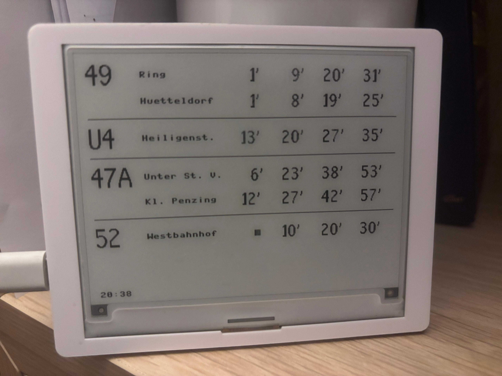

# ESP32 Wiener Linien Display

Real-time public transport departure display for Vienna (Wiener Linien) running on an ESP32-S3 with a 4.2" e-paper screen.


[](https://github.com/monsjovis/esp32-wiener-linien-display/actions/workflows/lint.yml)



## Features

- Real-time departure data from Wiener Linien API
- Configurable refresh cycle (default: 45 seconds, the API's rate limit)
- E-paper display with partial refresh (minimal flashing)
- Animated "arriving" indicator for imminent departures
- Grouped display by line with multiple destinations
- External configuration file (no code changes needed)
- Automatic Wi-Fi reconnection for 24/7 operation
- Button support for manual refresh
- Wi-Fi status indicator on display
- Watchdog timer for reliability
- Graceful error handling with stale data fallback
- Signed over-the-air updates from GitHub Releases, with automatic rollback

## Hardware

- **MCU**: ESP32-S3 ([CrowPanel 4.2" E-Paper HMI](https://www.elecrow.com/esp32-display-4-2-inch-e-paper-hmi-display-with-400-300-resolution-black-white-display.html))
- **Display**: SSD1683 400x300 e-paper via SPI
- **Power**: USB-C

### Pin Configuration

| Function | Pin |
|----------|-----|
| SPI SCK  | 12  |
| SPI MOSI | 11  |
| CS       | 45  |
| DC       | 46  |
| RST      | 47  |
| BUSY     | 48  |
| PWR      | 7   |
| HOME btn | 2   |
| EXIT btn | 1   |
| LED      | 41  |

## Project Structure

```
├── main.py              # Entry point, main loop
├── boot.py              # Installs staged updates, rolls back failed ones
├── config.json          # Configuration (stops, lines, intervals, updates)
├── secrets.json         # Wi-Fi credentials (not in git)
├── deploy.sh            # Deployment script
├── tools/release.py     # Builds and verifies an OTA release
├── tests/               # Host tests for the OTA update
└── lib/
    ├── config.py        # Configuration loader
    ├── crowpanel.py     # Hardware abstraction (buttons, LED)
    ├── wifi_manager.py  # Wi-Fi connection with reconnect
    ├── display.py       # E-paper rendering
    ├── fonts.py         # Bitmap fonts (24px, 16px)
    ├── ssd1683.py       # SSD1683 display driver
    ├── get_data.py      # API fetching and filtering
    ├── init_wifi.py     # Timezone and NTP sync
    ├── secrets.py       # Credential loader
    ├── urlencode.py     # URL encoding
    ├── utils.py         # Helper functions
    ├── ota.py           # OTA check, download, confirm
    ├── ota_policy.py    # OTA rules: signature, manifest, version, window
    ├── ota_key.py       # Public half of the release signing key
    └── version.py       # Running app version (stamped at release/deploy)
```

## Setup

### 1. Flash MicroPython

Flash the **SPIRAM_OCT** build of [MicroPython for ESP32-S3](https://micropython.org/download/ESP32_GENERIC_S3/)
(`ESP32_GENERIC_S3-SPIRAM_OCT-…-v1.27.0.bin`). The CrowPanel's ESP32-S3 has 8 MB of octal PSRAM
(`esptool flash_id` says "Embedded PSRAM 8MB"); the default build only probes for quad PSRAM,
logs `PSRAM chip is not connected, or wrong PSRAM line mode` at boot and runs on about 120 KB of
internal RAM.

```bash
esptool.py --chip esp32s3 --port /dev/cu.usbserial-110 write_flash -z 0 ESP32_GENERIC_S3-SPIRAM_OCT-20251209-v1.27.0.bin
```

Without `erase_flash` first the files on the device survive.

### 2. Configure Wi-Fi

Create `secrets.json` in the project root:

```json
{
  "wifi_ssid": "YOUR_SSID",
  "wifi_password": "YOUR_PASSWORD"
}
```

### 3. Configure Stops and Lines

Edit `config.json` to customize which stops and lines to monitor:

```json
{
  "stops": [
    {
      "diva": "60201438",
      "lines": {
        "49": [],
        "46": [],
        "N49": ["R"],
        "47A": []
      }
    },
    {
      "diva": "60200956",
      "lines": {
        "U4": ["H"]
      }
    },
    {
      "diva": "60200113",
      "lines": {
        "52": ["R"]
      }
    }
  ],
  "line_priority": ["49", "46", "N49", "U4", "47A", "52"],
  "destination_shortnames": {
    "HEILIGENSTADT": "Heiligenst.",
    "WESTBAHNHOF S U": "Westbahnhof"
  },
  "update_interval_sec": 45,
  "animation_interval_sec": 1,
  "full_refresh_interval_cycles": 600,
  "wlan": {
    "timeout_sec": 60,
    "reconnect_delay_sec": 5,
    "max_retries": 10
  },
  "stale_restart_threshold_sec": 300,
  "watchdog_timeout_ms": 90000,
  "ota": {
    "manifest_url": "https://github.com/MonsJovis/esp32-wiener-linien-display/releases/latest/download/manifest.json",
    "install_hours": [3, 5]
  }
}
```

### 4. Deploy to Device

Using [mpremote](https://docs.micropython.org/en/latest/reference/mpremote.html):

```bash
# Install mpremote
pip install mpremote

# Deploy all files (finds the one USB serial port; pass it when there are several)
./deploy.sh
./deploy.sh /dev/cu.usbserial-110
```

Or manually:

```bash
mpremote connect /dev/ttyUSB0 cp -r lib/ :lib/
mpremote connect /dev/ttyUSB0 cp main.py config.json secrets.json :
```

## Configuration

### config.json Reference

| Field | Description | Default |
|-------|-------------|---------|
| `stops` | Array of stops with DIVA ID and line filters | - |
| `stops[].diva` | Stop DIVA ID (from Wiener Linien API) | - |
| `stops[].lines` | Object mapping line names to directions | - |
| `line_priority` | Display order for lines | `["49", "46", "N49", "U4", "47A", "52"]` |
| `destination_shortnames` | Mapping of destination names to abbreviations | `{}` |
| `update_interval_sec` | Data refresh interval in seconds (lower hits the API rate limit) | `45` |
| `animation_interval_sec` | Arriving indicator toggle in seconds | `1` |
| `full_refresh_interval_cycles` | Partial refreshes before full refresh | `600` |
| `wlan.timeout_sec` | Wi-Fi connection timeout in seconds | `60` |
| `wlan.reconnect_delay_sec` | Delay before reconnection attempt in seconds | `5` |
| `wlan.max_retries` | Maximum reconnection attempts | `10` |
| `stale_restart_threshold_sec` | Restart device after stale for this many seconds | `300` |
| `watchdog_timeout_ms` | Watchdog timeout in milliseconds | `90000` |
| `ota.manifest_url` | Where the device looks for updates. Missing or empty = updates off | this repo's latest release |
| `ota.install_hours` | Local hours `[from, to)` in which an update may install | `[3, 5]` |

### Line Filters

- Empty array `[]` = all directions
- `["R"]` = outbound only (Richtung)
- `["H"]` = inbound only (Hin)
- `["R", "H"]` = both directions (same as empty)

### Finding DIVA IDs

Use the [Wiener Linien OGD API](https://www.data.gv.at/katalog/dataset/wiener-linien-echtzeitdaten-via-datendrehscheibe-wien) to find DIVA IDs for your stops.

## How It Works

1. **Boot**: Initialize hardware, display, connect to Wi-Fi, sync time via NTP
2. **Main loop** (configurable interval):
   - Check for button presses (HOME = manual refresh)
   - Check Wi-Fi connection, reconnect if needed
   - Fetch departure data from Wiener Linien API
   - Filter by configured lines/directions
   - Sort by priority (preferred lines first)
   - Render to e-paper with partial refresh
   - Draw Wi-Fi status indicator
3. **Animation**: Toggle arriving indicator every `animation_interval_sec`
4. **Stale data**: Auto-restart after 5 minutes without fresh data
5. **Watchdog**: 90-second timeout prevents hangs

### E-Paper Refresh Strategy

- **Partial refresh**: Used for regular updates (~0.5s, minimal flashing)
- **Full refresh**: Every `full_refresh_interval_cycles` updates to clear ghosting (~3s, full flash)

### Button Functions

| Button | Action |
|--------|--------|
| HOME   | Force immediate data refresh |
| EXIT   | (Reserved for future use) |

### Status Indicators

- **Signal bars** (bottom-right): Wi-Fi connected
- **X** (bottom-right): Wi-Fi disconnected
- **Warning triangle + "STALE Xs"** (center): Displaying stale data with age in seconds

## API

The device fetches data directly from the Wiener Linien OGD API:

```
https://www.wienerlinien.at/ogd_realtime/monitor?diva=60201438&diva=60200956
```

The response is transformed and filtered on-device to minimize memory usage.

## Over-the-air updates

The device updates its app (`main.py`, `config.json`, `lib/*.py`) from this repo's GitHub
Releases. The MicroPython firmware itself is not updated; that still needs USB.

**Publishing a release is a tag:**

```bash
git tag -a v1.0.1 -m v1.0.1 && git push origin v1.0.1
```

`.github/workflows/release.yml` then runs the tests, bundles the files with the version
stamped into `lib/version.py`, signs `manifest.json` and checks the result with the
device's own rules (`tools/release.py verify`) before publishing.

**On the device:**

- It checks once a day (5 minutes after boot, then every 24 h, after a failed check every
  hour) and installs only between 3 and 5 a.m. (`ota.install_hours`).
- Releases are signed with RSA-2048. `lib/ota_key.py` holds the public key; the private key
  is the `OTA_SIGNING_KEY` Actions secret. MicroPython does not verify TLS certificates, so
  the signature is what makes a release trustworthy: an unsigned or modified manifest, or a
  file that does not match its SHA-256, is never installed.
- A new build boots on trial and keeps itself after 3 successful departure fetches. If it
  cannot get there within 3 boots, `boot.py` restores the previous build and skips that
  version from then on. Restarts for want of network (stale data, failed Wi-Fi) count
  separately, up to 24 (1-2 hours), so an outage right after a night install does not throw
  away a good build. `boot.py` is never part of an update, so it survives a broken one.
- `deploy.sh` stamps `git describe` as the version, so a USB deploy at or after a tag is only
  replaced by a newer release.

**Signing key:** `ota_signing_key.pem` (gitignored). For a fork, make your own and point
`ota.manifest_url` at your repo:

```bash
openssl genpkey -algorithm RSA -pkeyopt rsa_keygen_bits:2048 -out ota_signing_key.pem
python3 tools/release.py pubkey ota_signing_key.pem   # writes lib/ota_key.py
gh secret set OTA_SIGNING_KEY < ota_signing_key.pem
```

## Development

### Linting

This project uses [ruff](https://docs.astral.sh/ruff/) for code quality checks:

```bash
pip install -r requirements-dev.txt
ruff check .
```

Linting runs automatically on push/PR to main via GitHub Actions.

### Tests

```bash
python3 -m unittest discover tests
```

They cover the OTA path on the host: signature, manifest rules, staging, install, rollback
and the release tool. They need `openssl` and run in CI next to the linter.

## Troubleshooting

### Wi-Fi Connection Failed

- Check `secrets.json` credentials
- Ensure 2.4GHz network (ESP32 doesn't support 5GHz)
- Check signal strength
- Increase `wlan.timeout_sec` in `config.json`

### Memory Errors

- The device runs garbage collection before HTTP requests
- Use the SPIRAM_OCT firmware (see Setup): with the default build the PSRAM stays off
- Reduce `full_refresh_interval_cycles` if issues persist

### Display Ghosting

- Decrease `full_refresh_interval_cycles` in `config.json`
- Or trigger manual full refresh by power cycling

### Wi-Fi Keeps Disconnecting

- The device automatically reconnects
- Increase `wlan.reconnect_delay_sec` if router needs more time
- Check router logs for connection issues

## License

MIT
